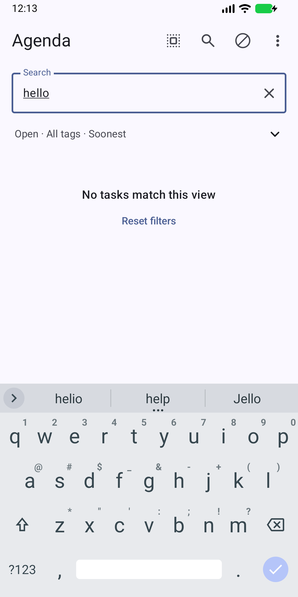
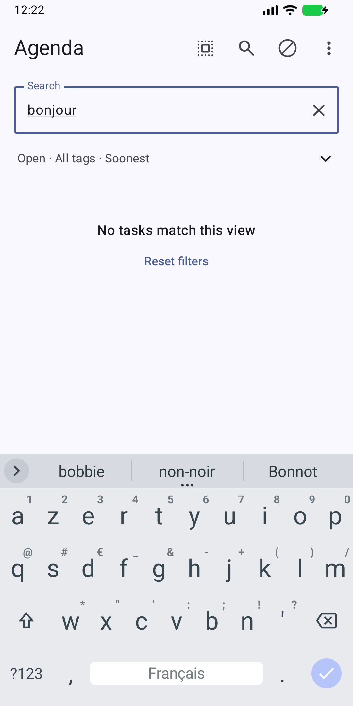
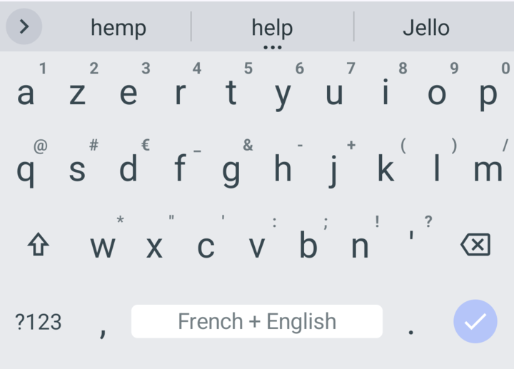

# Keyboard

Type in French and English on Android. Enable both languages in **Languages & Layouts** to add a combined input. Each standalone language keeps its own layout, and you can choose QWERTY or AZERTY for the shared one.

Keyboard began as a fork of [HeliBoard](https://github.com/HeliBorg/HeliBoard), which builds on OpenBoard and the Android Open Source Project keyboard. This project maintains the bilingual input, gesture suggestions and in-app update checks.

Switch languages with the language key or a long press on the spacebar. The combined input checks words from both dictionaries. You can also change key placement, adjust the theme and back up your settings and learned words. [English and French typing](docs/dual-language.md) · [Custom layouts](layouts.md)

Install the APK from the [download site](https://download.camille.studio). A signed update from HellBoard preserves the input method and its settings.

*Glide from H to O to enter “hello”. The suggestion strip shows alternatives.*

*The same decoder follows the French keyboard layout.*

*On this layout you can swipe “hello” and “bonjour” without changing languages.*

## Licenses and contributors

The Android update checker uses the [Apache-licensed updater 1.0.5 source](https://github.com/CamilleHbp/android-updater/tree/v1.0.5).

Keyboard uses [GPL version 3](LICENSE). The AOSP code carries its [Apache 2.0 license](LICENSE-Apache-2.0). The upstream icon carries [CC BY-SA 4.0](LICENSE-CC-BY-SA-4.0). Component notices and original copyright statements remain with their sources.

- Icon by [Fabian OvrWrt](https://github.com/FabianOvrWrt) with contributions from [The Eclectic Dyslexic](https://github.com/the-eclectic-dyslexic)
- [OpenBoard](https://github.com/openboard-team/openboard)
- [AOSP Keyboard](https://android.googlesource.com/platform/packages/inputmethods/LatinIME/)
- [LineageOS](https://review.lineageos.org/admin/repos/LineageOS/android_packages_inputmethods_LatinIME)
- [Simple Keyboard](https://github.com/rkkr/simple-keyboard)
- [Indic Keyboard](https://gitlab.com/indicproject/indic-keyboard)
- [FlorisBoard](https://github.com/florisboard/florisboard/)
- [HeliBoard contributors](https://github.com/HeliBorg/HeliBoard/graphs/contributors)
